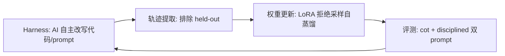

<div align="center">

# SIA-GPQA Reproduction

**Self-Improving AI (SIA) — Harness & Weight Updates 复现实验**

[](https://www.python.org/downloads/)
[](LICENSE)
[](https://arxiv.org/abs/2605.27276)
[](https://www.modelscope.cn/models/modelzhang/sia-qwen3-8b-gpqa-lora)
[](https://www.modelscope.cn/datasets/modelzhang/sia-gpqa-harness-trajectories)

*复现 [SIA: Self Improving AI with Harness & Weight Updates](https://arxiv.org/abs/2605.27276)（Hebbar et al., 2026）的完整实验：Harness 自我改进、Weight 权重更新、以及两者的串联。*

</div>

---

## 目录

- [项目简介](#项目简介)
- [核心结果](#核心结果)
- [架构与原理](#架构与原理)
- [快速开始](#快速开始)
- [实验全景](#实验全景)
- [文档索引](#文档索引)
- [目录结构](#目录结构)
- [引用与许可](#引用与许可)

---

## 项目简介

本项目对 **SIA（Self-Improving AI）** 框架做了端到端复现与扩展，完整跑通了：

| 环节 | 说明 |
|---|---|
| **Harness 模式** | AI 自主诊断执行轨迹中的缺陷，改进 target agent 的代码与 prompt |
| **Weight 模式** | 用轨迹数据做 LoRA 权重更新（拒绝采样自蒸馏），替代论文的 Tinker RL |
| **串联流程** | harness 产出的轨迹 → 权重更新 → 双 prompt 评测 |
| **本地推理** | 自建 Qwen3-8B OpenAI 兼容批处理服务，整套流程不依赖外部 API 推理 |

**交付物**：
- 🧠 训练好的 LoRA 模型：[ModelScope 模型](https://www.modelscope.cn/models/modelzhang/sia-qwen3-8b-gpqa-lora)
- 📊 完整轨迹数据集：[ModelScope 数据集](https://www.modelscope.cn/datasets/modelzhang/sia-gpqa-harness-trajectories)
- 📝 10 份实验报告 + 11 个可复现脚本 + 2 个推理服务

---

## 核心结果

### 三线实验结果

| 模式 | 底座 / 任务 | 结果 | 判定 |
|---|---|---|---|
| **Harness** | deepseek-v4-flash / GPQA | 89.90% → **94.44%**（+4.5pt） | ✅ 自我改进有效 |
| **Harness** | Qwen3-8B / GPQA | 未作答 190 → **16 题**，43.94% | ✅ 修复工程缺陷 |
| **Weight** | Qwen 2.5-3B / lawbench | 18.95% → **26.83%**（z=3.06, p<0.01） | ✅ 权重更新有效 |
| **Weight** | Qwen3-8B / GPQA | 65.00%（12 个配置均未突破） | ❌ 触及能力边界 |
| **串联** | Qwen3-8B / GPQA `disciplined` | 62.50% → **80.00%**（McNemar p=0.12） | ⚠️ 大幅提升，统计待确认 |

### 最重要的机制发现

> **训练是"条件激活"而非"内化"。**
>
> 同一份权重，仅改变 prompt：
>
> | prompt | 控制标签使用率 | GPQA 准确率 |
> |---|---|---|
> | `cot`（无标签指令） | 0% | 62.50% |
> | `disciplined`（显式要求 `<TEMP_LOW>/<TEMP_MID>/<TEMP_HIGH>`） | **92.5%** | **80.00%** |
>
> 学到的结构化推理需要 **prompt 触发** 才能生效——这与 D-CoT 论文"内化后不依赖标签"的主张不同。

### 两条边界（诚实说明）

1. **自我改进对"工程缺陷"有效，对"能力天花板"无效**——轨迹由同一模型生成，prompt 改变"怎么组织答案"，不能改变"知道什么"。
2. **feedback agent 的改进可能适得其反**——Gen 2 的"续写机制"推理合理但实际崩了（147/198 题未作答），暴露了缺少"改进效果验证"环节的问题。

> 完整细节（含逐题验证与统计检验）：[docs/FINAL_REPORT.md](docs/FINAL_REPORT.md)

---

## 架构与原理

```
            ┌──────────────────────────────────────────────────────────┐
            │                      自我改进循环                          │
            │                                                          │
   ┌────────▼────────┐   生成/改进    ┌──────────────┐   执行   ┌───────┴─────┐
   │   Meta Agent     │ ────────────► │  Target Agent │ ──────► │  任务 + 评测  │
   │ （deepseek-v4-pro）│              │ （Qwen3-8B 本地） │         │  (GPQA)      │
   └────────┬────────┘              └──────┬───────┘         └───────┬─────┘
            │                             │  执行轨迹                   │ 分数
            │        改进建议             │                            │
            └─────────────────────────────┴────────────────────────────┘
                        Feedback Agent（读代码 + 轨迹 + 分数，自主诊断）
```

**三阶段流程**：



**三种 Agent 分工**：

| Agent | 角色 | 输入 → 输出 |
|---|---|---|
| Meta Agent | 设计师 | 任务描述 + 参考 agent → 初版 `target_agent.py` |
| Target Agent | 执行者 | 任务数据 + 轨迹 → 答案 + 执行日志 |
| Feedback Agent | 审查者 | 代码 + 轨迹 + 分数 → 改进后的代码 |

---

## 快速开始

### 1. 安装环境

```bash
# Python 3.11+
pip install -r requirements.txt
# 另需（建议 CUDA 版）：
#   pip install torch --index-url https://download.pytorch.org/whl/cu124
#   pip install transformers>=4.51 peft trl datasets
```

### 2. 准备数据

```bash
# 从 ModelScope 下载：
# https://www.modelscope.cn/datasets/modelzhang/sia-gpqa-harness-trajectories
# 期望布局：
# data/
# ├── gpqa/data/private/diamond_questions.json   # 评测 ground truth
# ├── selfdist/final_train.json                  # 训练集（109 条）
# └── out/test_ids.json                          # held-out 40 题号
```

### 3. 训练 LoRA

```bash
python scripts/train_selfdist.py \
    --traj data/selfdist/final_train.json \
    --out out/final_harness \
    --epochs 3 --lr 1.5e-5 --bs 1 --accum 4 --max_len 8192
```

### 4. 评测（双 prompt 对照）

```bash
python scripts/eval_final.py out/final_harness/final_adapter out/eval.json 40
```

### 5. 加载模型（含 `disciplined` prompt）

```python
from transformers import AutoModelForCausalLM, AutoTokenizer
from peft import PeftModel
import torch

model = PeftModel.from_pretrained(
    AutoModelForCausalLM.from_pretrained(
        "Qwen/Qwen3-8B", torch_dtype=torch.bfloat16, device_map="auto"),
    "modelzhang/sia-qwen3-8b-gpqa-lora")
tok = AutoTokenizer.from_pretrained("Qwen/Qwen3-8B")

DISCIPLINED_PROMPT = """Question: {question}

Options:
{options}

Use a disciplined, bounded reasoning process with explicit control tags:
1) <TEMP_LOW> list the given quantities / facts and what is being asked (no speculation)
2) <TEMP_MID> do the single needed calculation or recall the needed fact
3) <TEMP_HIGH> ONLY if a second approach is genuinely needed, otherwise skip
Do NOT loop or restate. Then output exactly one final line: 'Answer: X'."""
```

> ⚠️ 推理时**必须使用 `disciplined` prompt**；普通 `cot` prompt 会使效果退化到 62.50%。

---

## 实验全景

### 权重更新 13 个配置（GPQA 40 题 held-out）

| # | 方法 | 数据量 | prompt | 准确率 |
|---|---|---|---|---|
| — | base Qwen3-8B | — | cot / disciplined | 65.00% / 62.50% |
| 1–2 | ORPO（老师格式·日常场景） | 1200 | cot / disc | 50.00% / 45.00% |
| 3–4 | ORPO（老师格式·STEM+难度） | 2100 | cot / disc | 32.50% / 55.00% |
| 5–6 | 自蒸馏（base 采样） | 84 | cot / disc | 57.50% / 50.00% |
| 7–8 | 教师混合（base 采样） | 128–136 | cot | 65.00% |
| 9 | 串联（harness 轨迹 + 教师） | 109 | cot | 62.50% |
| **10** | **串联 + disciplined** | **109** | disciplined | **80.00%** |

**失败模式总结**：纯老师格式数据让模型学到"表面格式"、压缩推理能力
（平均 token 从 8192 掉到 819–1055）；而 harness 轨迹 + 教师解法 + prompt 触发三者配合才有效。

---

## 文档索引

| 文档 | 内容 |
|---|---|
| [docs/FINAL_REPORT.md](docs/FINAL_REPORT.md) | **最终报告**：串联实验完整记录 + McNemar 检验（推荐先读） |
| [docs/REPORT.md](docs/REPORT.md) | 全景报告：harness + weights + 串联 |
| [docs/PIPELINE_EXPERIMENT.md](docs/PIPELINE_EXPERIMENT.md) | 串联实验详细过程 |
| [docs/WEIGHTS_REPORT.md](docs/WEIGHTS_REPORT.md) | 权重模式 12 个配置详析 |
| [docs/WEIGHTS_MODE.md](docs/WEIGHTS_MODE.md) | lawbench 成功案例（+7.88pt, p<0.01） |
| [docs/DCOT_EXPERIMENT.md](docs/DCOT_EXPERIMENT.md) | D-CoT 控制标签实验（负结果分析） |
| [docs/RESULTS.md](docs/RESULTS.md) | Harness 模式逐代结果 |
| [docs/REPRODUCTION.md](docs/REPRODUCTION.md) | 环境搭建与踩坑记录 |
| [docs/MODEL_CARD.md](docs/MODEL_CARD.md) | 模型卡片（ModelScope 同步） |
| [docs/DATASET_CARD.md](docs/DATASET_CARD.md) | 数据集卡片（ModelScope 同步） |

---

## 目录结构

```
.
├── sia-src/          # 原始 SIA 源码（MIT，归原项目所有）
├── scripts/          # 复现脚本
│   ├── extract_harness_traj.py   # 轨迹提取（自动排除 held-out）
│   ├── build_final.py            # 合并轨迹 → 训练集
│   ├── train_selfdist.py         # LoRA 自蒸馏训练
│   ├── train_rest.py             # lawbench 版自蒸馏
│   ├── train_law.py              # lawbench GRPO（备选）
│   ├── eval_final.py / eval_single.py   # 评测
│   ├── eval_base_law.py          # lawbench 基线评测
│   ├── gen_teacher_solutions.py / teacher_retry.py  # 教师解法
│   └── gen_dcot_v3.py            # D-CoT 偏好数据（负结果参考）
├── inference/        # 本地推理服务
│   ├── batch_server2.py          # Qwen3-8B 批处理服务（OpenAI 兼容）
│   └── local_server.py           # 简化版（支持 LoRA 热切换）
├── docs/             # 实验报告
├── requirements.txt
├── LICENSE           # MIT
└── README.md
```

---

## 引用与许可

```bibtex
@article{hebbar2026sia,
  title   = {SIA: Self Improving AI with Harness \& Weight Updates},
  author  = {Hebbar, Prannay and Manawat, Yogendra and Verboomen, Samuel and others},
  journal = {arXiv preprint arXiv:2605.27276},
  year    = {2026}
}
```

- SIA 原始源码：MIT（Copyright 2025 Hexo）
- 本项目脚本与文档：MIT（见 [LICENSE](LICENSE)）

## 贡献

欢迎提交 Issue 与 PR。请确保：

1. 不提交任何真实凭据（API key / token / 服务器信息）
2. 报告实验结果时同时给出效应量与统计检验
3. 保持 `held-out` 数据隔离约定

---

*生成于 2026-11-20 · 训练硬件：NVIDIA A800-SXM4-80GB · 教师模型：deepseek-v4-pro（LiteLLM 中转）*