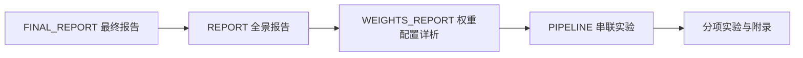

# 文档索引

本仓库的全部实验报告按主题组织。建议按下列顺序阅读。

---

## 📌 推荐阅读顺序

| 顺序 | 文档 | 一句话说明 |
|---|---|---|
| 1️⃣ | [FINAL_REPORT.md](FINAL_REPORT.md) | **最终结论**：串联 80% 突破 + McNemar 检验 + 全部配置对比 |
| 2️⃣ | [REPORT.md](REPORT.md) | 全景：harness + weights + 串联的完整记录 |
| 3️⃣ | [WEIGHTS_REPORT.md](WEIGHTS_REPORT.md) | 权重模式 12 个配置的逐项分析 |
| 4️⃣ | [PIPELINE_EXPERIMENT.md](PIPELINE_EXPERIMENT.md) | 串联实验的详细过程与机制解释 |
| 5️⃣ | 以下为分项与附录 | — |

---

## 实验类

| 文档 | 内容 | 关键数字 |
|---|---|---|
| [FINAL_REPORT.md](FINAL_REPORT.md) | 最终完整报告（其实验全集） | 串联 disciplined **80.00%**（p=0.12） |
| [REPORT.md](REPORT.md) | Harness + Weight 全景 | harness **94.44%**；lawbench **+7.88pt** |
| [PIPELINE_EXPERIMENT.md](PIPELINE_EXPERIMENT.md) | Harness → 权重更新串联 | 62.50% → **80.00%** |
| [WEIGHTS_REPORT.md](WEIGHTS_REPORT.md) | GPQA 上 12 个权重配置 | 最高 65.00%（= base） |
| [WEIGHTS_MODE.md](WEIGHTS_MODE.md) | lawbench 成功案例 | **+7.88pt**（z=3.06, p<0.01） |
| [DCOT_EXPERIMENT.md](DCOT_EXPERIMENT.md) | D-CoT 控制标签实验 | 标签"条件激活"机制 |
| [RESULTS.md](RESULTS.md) | Harness 逐代结果 | 89.90% → **94.44%** |

## 工程类

| 文档 | 内容 |
|---|---|
| [REPRODUCTION.md](REPRODUCTION.md) | 环境搭建、中转站接入、踩坑记录（25 项） |

## 发布物

| 文档 | 对应 ModelScope 仓库 |
|---|---|
| [MODEL_CARD.md](MODEL_CARD.md) | [模型：sia-qwen3-8b-gpqa-lora](https://www.modelscope.cn/models/modelzhang/sia-qwen3-8b-gpqa-lora) |
| [DATASET_CARD.md](DATASET_CARD.md) | [数据：sia-gpqa-harness-trajectories](https://www.modelscope.cn/datasets/modelzhang/sia-gpqa-harness-trajectories) |

---

## 关键术语

| 术语 | 含义 |
|---|---|
| **Harness 模式** | SIA 通过改写 target agent 的代码/prompt 实现自我改进 |
| **Weight 模式** | 通过 LoRA/R L 更新模型权重实现自我改进 |
| **拒绝采样自蒸馏** | 只保留模型答对的轨迹做 SFT |
| **条件激活** | 学到的结构化推理需要 `disciplined` prompt 触发才生效 |
| **held-out** | 严格隔离的 40 题评测集，不参与任何训练 |

---

*文档索引更新于 2026-11-20*